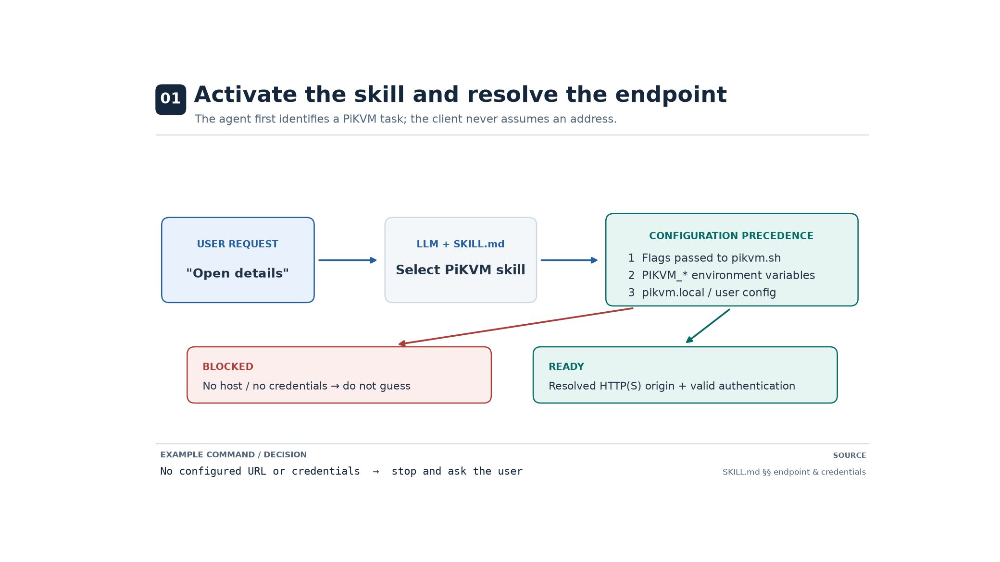
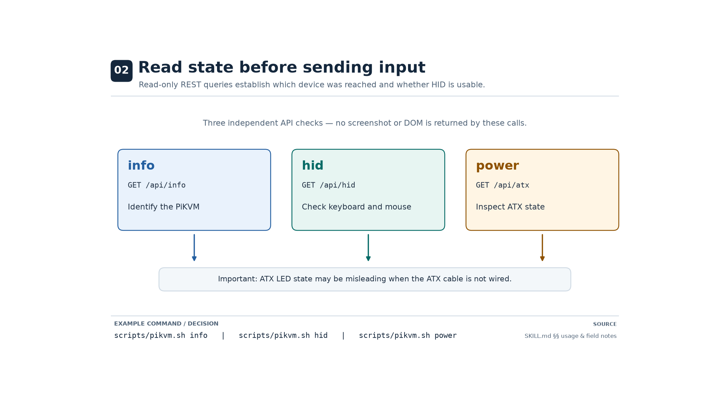
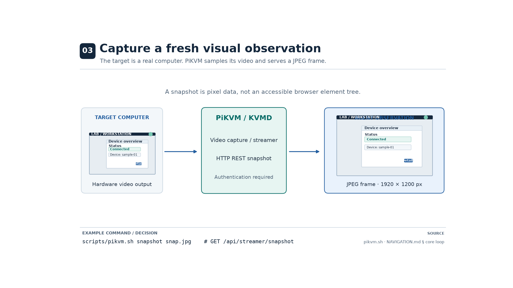
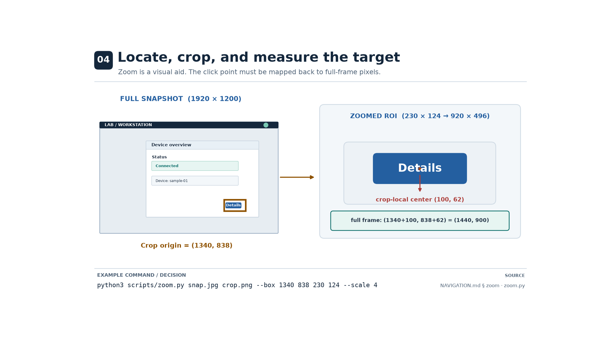
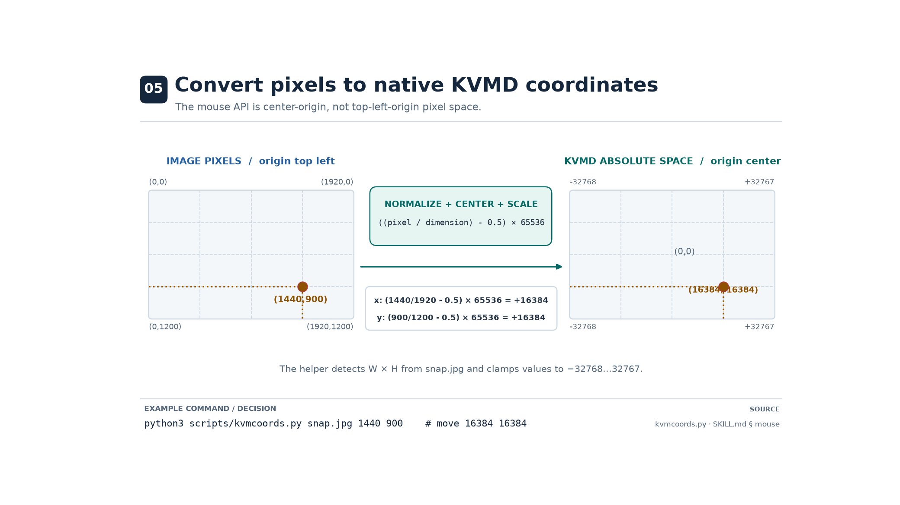
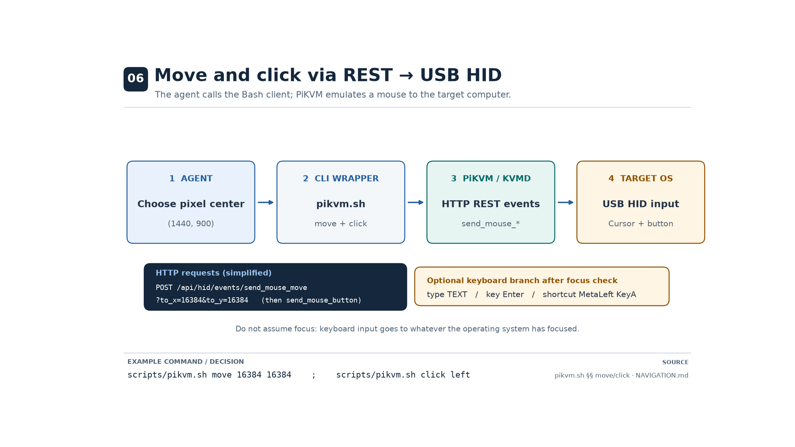
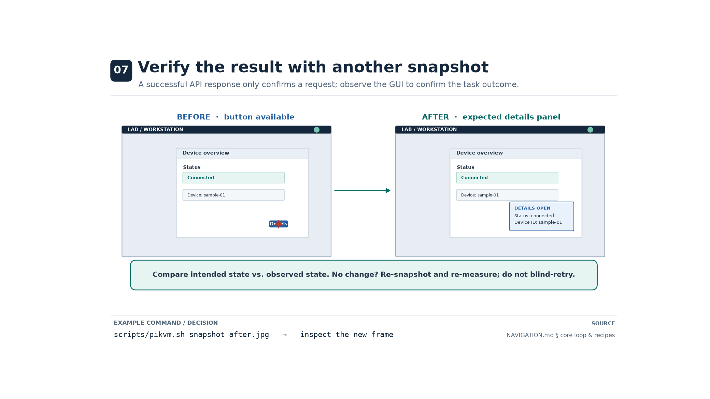
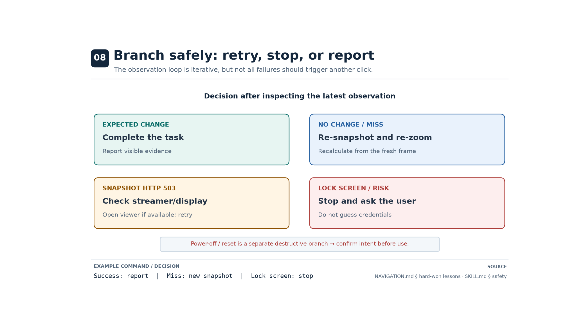

# pikvm-rest-api — an Agent Skill

An [Agent Skills spec](https://agentskills.io/specification) skill that gives AI agents control over a
[PiKVM](https://github.com/pikvm/pikvm) / [KVMD](https://github.com/pikvm/kvmd) (PiKVM Mini) hardware KVM
through its REST API: read system and power state, send real keyboard/mouse input, type text, capture the
screen, and control ATX power — with a zero-dependency bash + curl client.

**If you are an agent:** skip to [`pikvm-rest-api/SKILL.md`](pikvm-rest-api/SKILL.md). That file — plus
`references/` on demand — is the documentation the skill was designed to give you.

**If you are human:** keep reading. This page is the human-facing guide, with a step-by-step visual
walkthrough of exactly how an agent drives a machine through the skill.

---

## How it works, step by step

The eight figures below are a **visual, university-course-quality walkthrough** of the end-to-end
computer-use procedure an agent follows when it activates this skill. All screens and numbers are
**illustrative simulations** — the machine, its UI, and its state are simulated; no PiKVM was contacted.
They are generated programmatically (reproducible source in [`docs/`](docs/), regeneration instructions
further below), and their numbers match this repository's scripts and documentation.

### 1 · Activate the skill and resolve the endpoint



A task arrives ("open the details panel on the lab workstation"), the agent recognizes it as a PiKVM
task, and the skill activates. The client then resolves the KVM's base URL and credentials at runtime —
**flags → environment variables → local config file**, first match wins. If nothing is configured, the
workflow *stops and asks the user* rather than guessing a host. (The KVM's address and password are
private to your network; they are deliberately never hardcoded in this repo.)

### 2 · Read state before sending input



Before touching anything, the agent makes read-only REST calls — `info` (which PiKVM and host did I
reach?), `hid` (are the keyboard and mouse emulators online, is the mouse in absolute mode?), and
`power` (ATX state). These return JSON telemetry, **not** pixels of the target screen — and on setups
where the ATX cable isn't wired, `power` can even be wrong about whether the machine is on.

### 3 · Capture a fresh visual observation



`pikvm.sh snapshot snap.jpg` makes `GET /api/streamer/snapshot`; KVMD returns a JPEG frame of the remote
screen. The agent perceives **pixels** — there is no browser DOM and no accessibility tree behind this
API. Every action that depends on the screen starts from a snapshot taken *just now*, never an old one.

### 4 · Locate, crop, and measure the target



The agent finds the control it needs in the current frame. Small controls (10–20 px tall at full-frame
resolution) are too small to measure reliably, so it crops the region of interest and upscales it with
`scripts/zoom.py` — here a 230×124 crop at origin (1340, 838), upscaled 4× to a 920×496 view. The
target's center is then measured **crop-locally** (100, 62) and translated back to full-frame pixels:
(1340+100, 838+62) = (1440, 900).

### 5 · Convert pixels to native KVMD coordinates



`pikvm.sh move X Y` does **not** take screen pixels. KVMD's absolute-mouse mode is *center-origin*:
(0,0) is the screen center and coordinates span roughly −32768…32767. The conversion is
`((px / W) − 0.5) × 65536` per axis — here (1440, 900) on a 1920×1200 frame becomes (16384, 16384).
`scripts/kvmcoords.py` does this arithmetic for you, reading the frame size straight out of the JPEG
header.

### 6 · Move and click via REST → USB HID



The bash wrapper sends `POST /api/hid/events/send_mouse_move?to_x=…&to_y=…` and then
`send_mouse_button`. From there the PiKVM itself is a USB mouse/keyboard to the target operating system:
REST call → PiKVM firmware → USB HID → cursor moves, button presses. Keyboard commands (`type`, `key`,
`shortcut`) follow the same path through the USB keyboard — input is **real**, and it acts on whatever
the target OS currently has focused.

### 7 · Verify the result with another snapshot



The agent takes a *new* snapshot and compares it against the expected outcome. An HTTP 200 only proves
the request was accepted — it does **not** prove the cursor landed on the intended control or that the
application did the right thing. If nothing changed: re-snapshot, re-measure, never blind-retry.

### 8 · Branch safely: retry, stop, or report



The loop is iterative, but the agent knows which failures deserve another click and which deserve a
stop. Expected change → report the visible result. Miss → fresh frame, repeat. `snapshot` 503 (video
streamer offline) → wake the stream via the PiKVM web UI once, then retry. **Lock screen or anything
irreversible → stop and ask the user** — destructive ATX power actions require explicit confirmation.

A concrete, fully-worked example of this whole sequence — the exact commands, the coordinate math, and
the caveats, all on the same simulated screen as every figure — is in
[`docs/WORKED_EXAMPLE.md`](docs/WORKED_EXAMPLE.md).

---

## What the skill does

`scripts/pikvm.sh` is a zero-dependency (bash + curl) KVMD REST client:

| Area | Commands |
|---|---|
| State (read-only) | `info` · `power` · `hid` |
| Input (real events on the target) | `key` · `shortcut` · `type` · `click` · `move` · `wheel` |
| Screen | `snapshot FILE.jpg` |
| Power (destructive — confirm first) | `power-on` · `power-off` · `power-reset` |
| Escape hatch | `raw METHOD PATH K=V …` (the API uses query params, not form bodies) |

Plus two helpers for GUI driving: `scripts/kvmcoords.py` (pixel → KVMD coordinates, stdlib only) and
`scripts/zoom.py` (crop + upscale, needs Pillow). Key names use the KVMD *web* keymap (`KeyA`,
`MetaLeft`, `Digit1`, …) — see `pikvm-rest-api/references/KEYMAP.md`.

## Configuration (the portable part)

The skill ships **no URL and no credentials of any kind**. Everything is resolved at runtime,
first match wins per value:

1. `--base-url` / `--user` / `--password` flags (one-off)
2. `PIKVM_URL` / `PIKVM_USER` / `PIKVM_PASSWORD` environment variables
3. `pikvm.local` next to the skill (gitignored; template in `pikvm-rest-api/pikvm.example`),
   or `~/.config/pikvm/endpoint`

TLS: PiKVM usually ships a self-signed cert — set `PIKVM_INSECURE=true` (or `--insecure`), or point
`PIKVM_CA` at a CA bundle. This is what keeps the repo public-safe: your KVM's internal address and
password live in *your* env vars or *your* gitignored file, and the public copy works for anyone who
points it at their own PiKVM.

## Install

### Project scope (one repo)

```bash
cp -r pikvm-rest-api /path/to/your/repo/.agents/skills/
```

### User scope (all your repos)

```bash
cp -r pikvm-rest-api ~/.agents/skills/
```

Then start a new agent conversation so the skill catalog is rebuilt. In OpenHands you can verify under
**Customize > Skills** — `pikvm-rest-api` should appear and be enabled.

### Point it at your KVM

```bash
export PIKVM_URL=https://your-kvm-host
export PIKVM_USER=admin
export PIKVM_PASSWORD='your-password'
export PIKVM_INSECURE=true        # self-signed cert (the PiKVM default)
```

…or in the skill directory:

```bash
cp pikvm-rest-api/pikvm.example pikvm-rest-api/pikvm.local
# edit PIKVM_URL / PIKVM_USER / PIKVM_PASSWORD
```

## How the agent side of the docs is organized

The skill follows the Agent Skills spec's [progressive disclosure](https://agentskills.io/specification#progressive-disclosure)
model, so the human and agent views of this repo are deliberately different:

| Layer | When loaded | What the agent sees |
|---|---|---|
| `name` + `description` frontmatter | always (skill catalog) | ~100-token summary of what/when |
| [`pikvm-rest-api/SKILL.md`](pikvm-rest-api/SKILL.md) | when the skill activates | endpoint resolution, all commands, field notes, safety rules |
| `pikvm-rest-api/references/*` | only when a task needs them | `KEYMAP.md` (key names), `NAVIGATION.md` (the click/type/read-screen loop) |
| `pikvm-rest-api/scripts/*` | only when run | the actual bash/python clients |

So a human landing on this page reads the visuals above and the prose; an agent installing the skill
never has to read this README — it gets the compact `SKILL.md` on activation and pulls in the
references on demand. The mechanism is in the install step above: only `pikvm-rest-api/` is copied
into the agent's skill directory, while this README and `docs/` stay at the repository root for
humans. That's the spec working as intended: one repo, two audiences, each getting the documentation
shaped for it.

## Regenerating the step visualizations

The eight walkthrough figures are generated programmatically — no hand-drawn pixels. The source lives
in this repository, next to the figures it produces:

```
docs/
├── generate_pikvm_diagrams.py   # generator: functions make01..make08, one per step
├── critic_checks.py             # deterministic QA: geometry, math, contrast, file sanity
├── WORKED_EXAMPLE.md            # the concrete command sequence behind the figures
├── REVIEW.md                    # editorial review log, ratings, and caveats
└── figures/                     # generated output: 8 × PNG (2080×1170) + 8 × SVG (editable)
```

To regenerate everything:

```bash
# 1. dependencies (Python 3; matplotlib pulls in numpy)
python -m pip install matplotlib pillow

# 2. generate all figures (PNG + SVG) into docs/figures/
python docs/generate_pikvm_diagrams.py --output-dir docs/figures

# 3. verify: coordinate math, crop/zoom geometry, file sizes, WCAG contrast
python docs/critic_checks.py
```

`generate_pikvm_diagrams.py` embeds the worked example's constants (1920×1200 frame, target pixel
(1440, 900), crop (1340, 838, 230, 124), 4× scale, 65536 KVMD span) as module-level variables with
`assert`-checked invariants, and it prints each output path. `critic_checks.py` is a deterministic
programmatic critic — it re-checks the pixel→KVMD mapping, crop offsets, zoom dimensions, and a set of
text/background contrast ratios (≥ 4.5:1). [`docs/REVIEW.md`](docs/REVIEW.md) records the human-oriented
editorial critique, per-step ratings, and the remaining caveats (illustrative UI, no hardware test,
independent peer review still recommended before publication).

## Repository layout

```
├── README.md               # this file — human-facing guide + visual walkthrough
├── pikvm-rest-api/         # the skill itself (what agents install)
│   ├── SKILL.md            #   skill definition: frontmatter + agent instructions
│   ├── pikvm.example       #   config template (copy to pikvm.local, gitignored)
│   ├── scripts/            #   pikvm.sh, kvmcoords.py, zoom.py
│   └── references/         #   KEYMAP.md, NAVIGATION.md (loaded on demand)
└── docs/                   # this page's supporting material
    ├── figures/            #   the eight step visuals (PNG + SVG), committed
    ├── generate_pikvm_diagrams.py
    ├── critic_checks.py
    └── REVIEW.md
```

## Spec compliance

Valid against the [Agent Skills spec](https://agentskills.io/specification): `name` matches the parent
directory, lowercase-hyphen naming, required `name` + `description` frontmatter, description ≤ 1024
chars, body well under 500 lines. Optional spec fields used: `compatibility` (requires bash/curl +
network) and `metadata` (author, version). No non-spec fields, so the skill is portable to any
spec-compliant client. Validate with `skills-ref validate ./pikvm-rest-api`.
